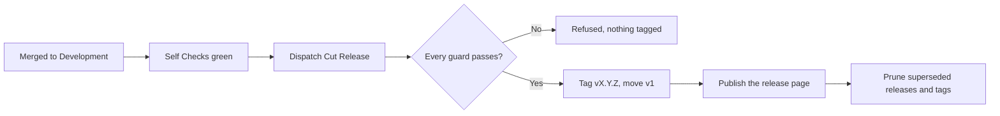

<!--
title: '🏷️ RELEASING THESE STANDARDS'
description: 'How this repository releases itself with 🏷️ Cut Release: choosing the version, what each guard refuses, what a run publishes and prunes, what consumers see, and what a new major involves. Read it before moving v1.'
type: guide
-->

<!-- markdownlint-disable MD041 -->

# 🏷️ RELEASING THESE STANDARDS

**How a merged change here becomes the code every repository pinned to `@v1` runs.**

_Merge first. Move the major second._

---

## 💡 What A Release Does

**🏷️ Cut Release** ([`release.yml`](../../.github/workflows/release.yml)) is the same workflow other
repositories call from a stub; dispatched here, it releases these standards. One run checks the
version and the commit, tags `vX.Y.Z`, force-moves `vX` onto it, publishes the release page, and
prunes every release the new one superseded, page and tag. Afterwards the repository carries `v1`, the
one version it points at, and that version's release page.

Every repository pinned to `@v1` then runs the new code on its next workflow run. Nothing on their
side changes or asks first, which is why the workflow's header calls it the most consequential one
here, and why it refuses so much.

---

## 🔢 Choosing The Version

Nothing computes the version here: you type it into the dispatch form.

- **Patch or minor**, by the commits since the last release:
  [Releases & Versioning](Releases-&-Versioning.md#-versioning-policy-semver) maps each commit type
  to its bump.
- **A breaking change waits for the next major.** The workflow's header names three: renaming a
  required check, removing an input, and changing a default in a way that alters behaviour. The three
  required checks, and the stub job ids they hang on, are fixed in
  [The Check-Name Contract](../../data/README.md#-the-check-name-contract).
- **It must move forward.** The version is `vX.Y.Z`, not yet tagged, and newer than the newest
  published version, compared as numbers, so `v1.10.0` follows `v1.9.0`.

---

## 🚀 Cutting One

- [ ] The change is merged to the default branch, `Development`, and 🚦 Self Checks is green on that
      commit.
- [ ] Every input or output an action gained or lost is mirrored in its forwarder under
      [`actions/`](../../actions/README.md). Nothing checks this for you.
- [ ] Open **Actions → 🏷️ Cut Release → Run workflow**, leave the branch on `Development`, set
      `version` to `vX.Y.Z`, and leave `move-major` on.
- [ ] Read the run summary: the version cut, and `v1` now pointing at it.

One release runs at a time: a second dispatch waits for the first to finish.

> [!WARNING]
> **Leave `move-major` on.** With it off, the version is tagged and published but `v1` stays where it
> was, and the prune still runs. It keeps only the newest release, so it deletes the release and the
> tag that `v1` stands on.

---

## 🛡️ What The Run Refuses

A refusal tags nothing: every guard runs before the first tag is written.

| Guard               | Refuses when                                                                                                                                               | What to do                                            |
| :------------------ | :--------------------------------------------------------------------------------------------------------------------------------------------------------- | :---------------------------------------------------- |
| Version format      | `version` is not `vX.Y.Z`                                                                                                                                  | Type it again                                         |
| Already tagged      | The tag exists. A published version is immutable                                                                                                           | Cut the next patch                                    |
| Release line        | The default branch cannot be resolved, or the commit is not on it. Checked by ancestry, so the branch's name does not matter                               | Merge first, then dispatch against `Development`      |
| Forward only        | The published releases cannot be read, or the version is not newer than the newest of them                                                                 | Pick a newer version; a read failure is worth a rerun |
| Internal references | A workflow or action here names `tannergolden/standards/.github/actions/<name>@`, or an old `actions/<name>@` address, with no `action.yml` at this commit | Add the action, or fix the reference                  |

The step after them, **🧪 Verify The Release Candidate**, proves the `required-files` and
`check-command` a calling stub passes. A dispatch here passes neither, and the step says so and moves
on: the proof for these standards is 🚦 Self Checks.

---

## 📦 What It Publishes

- **Two lightweight tags**, `vX.Y.Z` and the force-moved `v1`. A lightweight tag has no tag object to
  sign, so what GitHub verifies is the commit, and no signing key sits in the repository's secrets.
- **A warning annotation**, `Major tag moved`, saying every repository pinned to `@v1` runs this code
  on its next workflow run.
- **The release page**, titled with the version and marked latest. GitHub writes its notes, and
  [`.github/release.yml`](../../.github/release.yml) sorts the pull requests by their labels: breaking
  changes under `semver: major`, then deprecations, security, features, bug fixes, performance,
  documentation and dependencies, with everything else under Maintenance & Other.

---

## 🧹 What It Prunes

After the release, the `prune` job calls
[`prune-releases.yml`](../../.github/workflows/prune-releases.yml) at `@v1`, by its full name, with
`keep: 1`, `delete-tags: true` and `dry-run: false`:

- Every published release but the newest by publish date is deleted, and its tag with it. Drafts and
  prereleases are left alone.
- Every other plain `vX.Y.Z` tag that no kept release stands on is deleted too.
- A bare major such as `v1` is never deleted, nor any tag that is not a plain `vX.Y.Z`.

A calling stub can keep every version with `keep-versions`; a dispatch here has no such input, so these
standards always prune. A pin to a full version therefore lasts until the next release, and a commit
SHA is the pin that lasts ([Consuming These Standards](../../README.md#-consuming-these-standards)).

---

## 📣 What Consumers See

- **A minor or a patch** reaches every stub pinned to `@v1` on its next run, and nothing in their tree
  changes. A stub pinned to the version just superseded stops resolving, because its tag is gone.
- **A new major moves no pin.** `@v1` keeps resolving to the last v1 release. A repository that runs
  ⬆️ Standards Version ([`standards-version.yml`](../../.github/workflows/standards-version.yml))
  reads this repository's latest release, and when its major is newer than the stalest pin in the
  repository's stubs, opens one issue that lists each stub and its pin. It never opens a second issue
  for the same major, and changes no file.

---

## 🔭 Releasing A New Major

What the workflows do today decides what a `v2.0.0` involves:

- **The major moved is the version's own.** Cutting `v2.0.0` creates `v2` and leaves `v1` where it
  was, so every caller on `@v1` keeps running the last v1 release.
- **The prune then takes the last v1 version**, page and tag, because it keeps only the newest
  release. The bare `v1` stays.
- **The v1 line closes.** The forward-only guard compares against the newest published version, so
  once `v2.0.0` exists Cut Release refuses every `v1.x`.
- **Every first-party reference here names `@v1`**: each workflow's actions and `release.yml`'s
  prune. Once `v2` exists `v1` stops moving, so a v2 that keeps those references runs v1's actions.
- **The forwarders go.** [ADR-0001](../adrs/ADR-0001-Actions-And-Scripts-Live-In-Github.md) deletes
  `actions/` at the next major, and drops it from 🚦 Self Checks and from the release's reference
  check.

---

## 🔗 See Also

- [Working On These Standards](../introduction/Working-On-These-Standards.md), for everything before
  the merge.
- [Releases & Versioning](Releases-&-Versioning.md), the release standard for every repository.
- [Reusable Workflows](../../.github/workflows/README.md#pruning-and-release), for the stub another
  repository consumed by tag uses to call the same workflow.

---

**One dispatch moves every pin. Make it the right one.**

[↑ Back to Top](#top)

 

Built with ❤️ by the Engineering Team. Distributed under the MIT License.

