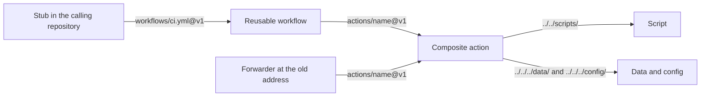

<!--
title: '🏗️ AUTOMATION ARCHITECTURE'
description: 'How the automation these standards ship fits together: the layers a call passes through, the ref each one resolves at, where an action finds its files, and the shape every workflow, action and script here keeps. Read it before adding or changing one.'
type: guide
-->

<!-- markdownlint-disable MD041 -->
<div align="center">

# 🏗️ AUTOMATION ARCHITECTURE

<a name="top"></a>

**The layers a call passes through, what each resolves, and the shape each one keeps.**

_A stub calls, a workflow describes, an action ships._

</div>

---

## 💡 Four Layers And A Forwarder

A consumer's run passes through up to four kinds of file, and only an action, with what it ships, can
read this repository. Why the line falls there is in
[Why These Exist Separately](../../../.github/actions/README.md#-why-these-exist-separately).



| Layer             | Lives in                                      | Called as                                                            | Resolved at                                                       |
| :---------------- | :-------------------------------------------- | :------------------------------------------------------------------- | :---------------------------------------------------------------- |
| Stub              | The calling repository's `.github/workflows/` | Nothing calls it: GitHub runs it on an event                         | The calling repository's ref                                      |
| Reusable workflow | `.github/workflows/<file>.yml`                | `tannergolden/standards/.github/workflows/<file>@v1`, as a job       | The ref the stub names                                            |
| Composite action  | `.github/actions/<name>/action.yml`           | `tannergolden/standards/.github/actions/<name>@v1`, as a step        | The ref in that `uses:`, `@v1` from every workflow                |
| Script            | `.github/scripts/`                            | `${GITHUB_ACTION_PATH}/../../scripts/<file>`, from an action         | The action's ref: it arrives with the action                      |
| Data and config   | `data/` and `config/`                         | `${GITHUB_ACTION_PATH}/../../../data/` or `/config/`, from an action | The action's ref                                                  |
| Forwarder         | `actions/<name>/action.yml`                   | The old address, `tannergolden/standards/actions/<name>@v1`          | The old address's ref, passing every input to the action at `@v1` |

---

## 📌 What Resolves Where

1. **A workflow names every first-party action in full, at `@v1`.** A `./` path inside a reusable
   workflow resolves against the calling repository
   ([Things That Will Surprise You Once](../../../.github/workflows/README.md#%EF%B8%8F-things-that-will-surprise-you-once)),
   so there is no relative form to use. A workflow that calls another names it in full for the same
   reason, as `release.yml` calls `prune-releases.yml@v1`.
2. **The actions follow `v1` whatever the stub pins.** A stub pinned to a version or a commit freezes
   the workflow's own jobs, while the actions inside them still resolve `@v1`.
3. **Shared files come from the action's ref, not the caller's tree.** `sync-labels` with no
   `labels-file` applies `data/labels.yml` as it stood in the release it resolved, so applying a
   registry edited here before it is released means naming the file. The `config` action works the
   same way: it copies the file from its own checkout unless the workflow's override input names one
   in the calling repository ([Who Reads Each File](../../../config/README.md#%EF%B8%8F-who-reads-each-file)).
4. **🚦 Self Checks is the one caller that reads the tree.** It calls `./.github/actions/harden` and
   `./.github/workflows/codeql.yml` by local path, so a pull request tests its own change. Inside
   `codeql.yml` the actions still resolve `@v1`, as they do for every consumer.

---

## 🔎 Finding What A Change Reaches

A change to an action reaches every workflow that names it. Search for its address:

```bash
grep -rln 'tannergolden/standards/.github/actions/config@' .github/workflows
```

Nearly every job opens with `harden`, so a change to it reaches almost every run. `release.yml` is the
exception: it pins the runner-hardening action itself.

---

## ⚙️ The Shape Of A Reusable Workflow

- **A header comment** opening `# --- Reusable Workflow ---`, with the workflow's name, a `Purpose:`
  line and, after `Called, not triggered.`, the stub that calls it. `release.yml`, which is also
  dispatched here, has a header of its own and keeps its stub in the
  [workflows README](../../../.github/workflows/README.md).
- **`permissions: {}` at the top**, and each job names the scopes it needs, most with a comment
  saying why: `contents: write # create tags and publish the release`.
- **`harden` as the first step**, usually with a `notice:` that says what the job does.
- **Third-party actions pinned to a full commit SHA**, with the version in a comment beside it.
- **Inputs reach a `run:` block through `env:`.** No `run:` block here interpolates `${{ }}` into its
  shell.
- **A job name a ruleset requires never changes inside a major.** A called workflow reports its
  check as `<caller job id> / <job name>`, so the name is half of every required check
  ([The Check-Name Contract](../../../data/README.md#%EF%B8%8F-the-check-name-contract)).

---

## 🧩 The Shape Of A Composite Action

- **A header comment** opening `# --- Composite Action ---`, with the action's name, a `Purpose:`
  line and a `Used as:` example.
- **`name` and `description`.** The description is the row its folder log shows, and its forwarder
  repeats it.
- **`runs.using: composite`, and `shell: bash` on every `run:` step**, most of them opening with
  `set -euo pipefail`. 🚦 Self Checks fails a `run:` step with no `shell:`.
- **Inputs through `env:`**, never interpolated into the shell.
- **Its files by path from `${GITHUB_ACTION_PATH}`**: `../../scripts/` for a script, `../../../data/`
  and `../../../config/` for shared files. Self Checks fails a path that does not exist, and fails
  when it finds no paths at all, since that means its pattern stopped matching.
- **A `README.md` beside it**, in the form its siblings share.

---

## 🐍 The Shape Of A Script

- **Python 3's standard library, or bash**, so it runs on a bare runner. `sync-labels.sh` uses PyYAML
  when the runner has it and falls back to a strict line parser when it does not.
- **A shebang, the SPDX lines, then a banner comment or a docstring** whose first line names the script
  and what it does. That line is its row in the [scripts log](../../../.github/scripts/README.md).
- **Inputs from environment variables** that the action fills from its own inputs, or from flags for
  the generators `make` runs, such as `--check` and `--write`. Either way the header names them.
- **Failures as annotations**, `::error title=<subsystem>::<what happened, and the fix>`, written to
  the rules in [How A Failure Announces Itself](../../operations/Troubleshooting.md#-how-a-failure-announces-itself).
- **Tests in `tests/`**, which [The Test Suite](Test-Suite.md) describes.

---

## 🔗 See Also

- [Working On These Standards](../../introduction/Working-On-These-Standards.md), for what changes
  together when you add one of these.
- [ADR-0001](../../adrs/ADR-0001-Actions-And-Scripts-Live-In-Github.md), for why the actions and
  scripts sit under `.github/` and the forwarders at the old addresses.
- [Reusable Workflows](../../../.github/workflows/README.md) and
  [Composite Actions](../../../.github/actions/README.md), for what each one does.

---

<div align="center">

**Each layer reads only what it was handed.**

[↑ Back to Top](#top)

<br />

Built with ❤️ by the Engineering Team. Distributed under the terms in [LICENSE](/LICENSE).

</div>
